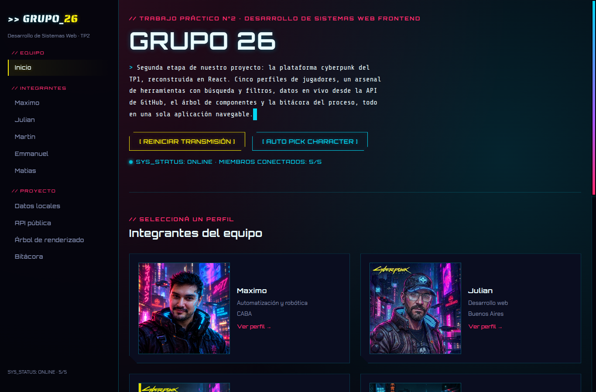
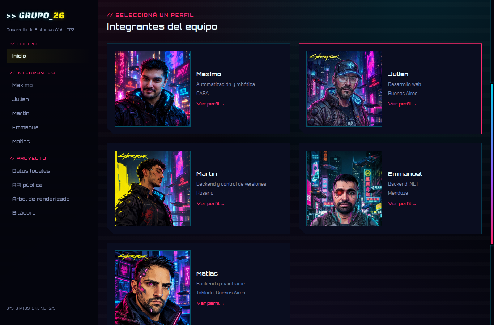
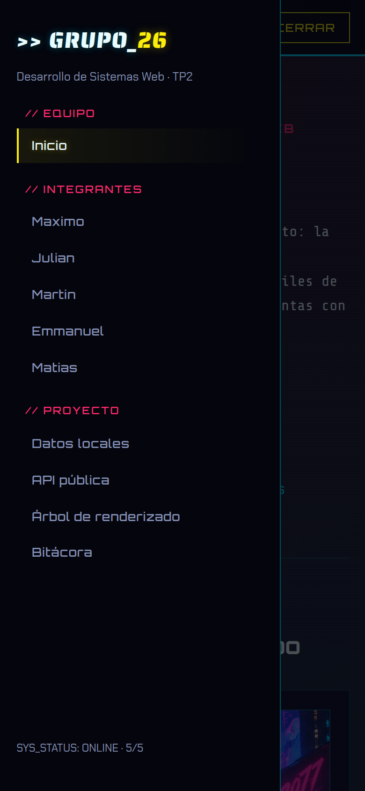
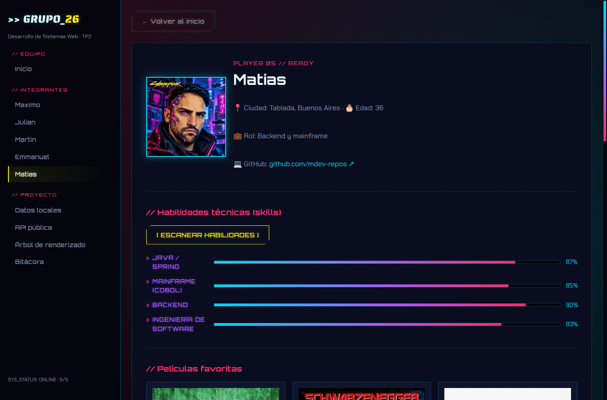
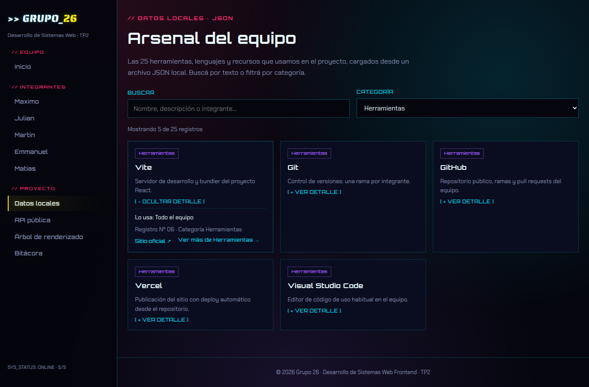
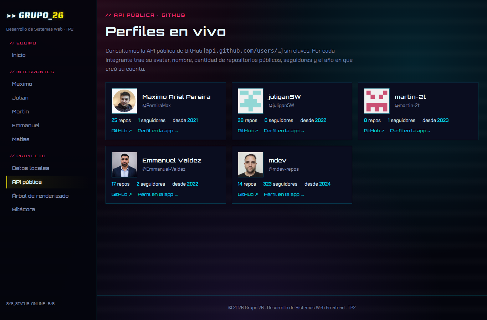
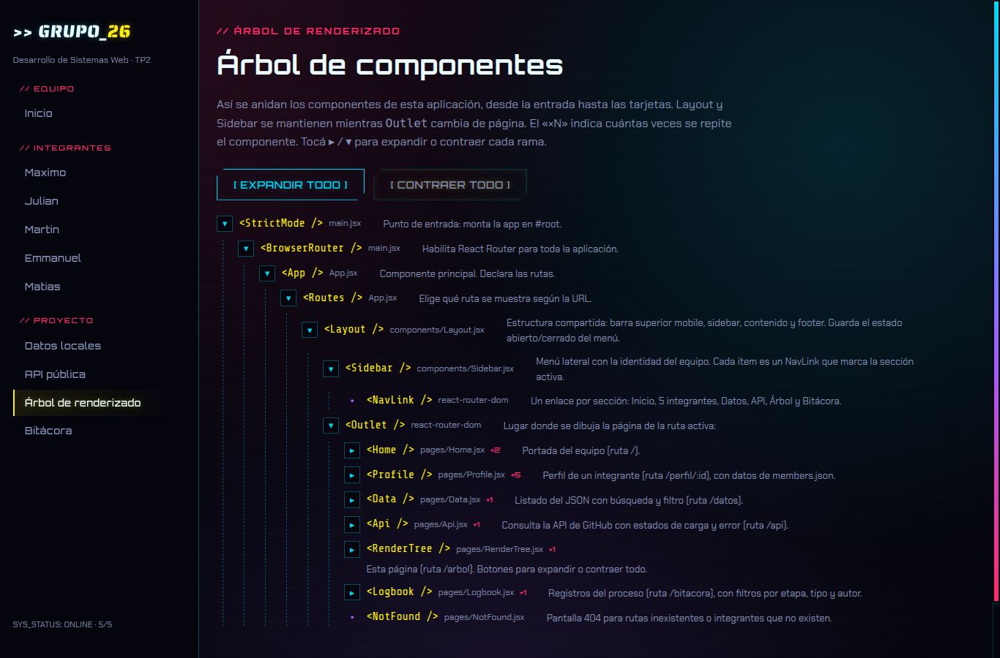
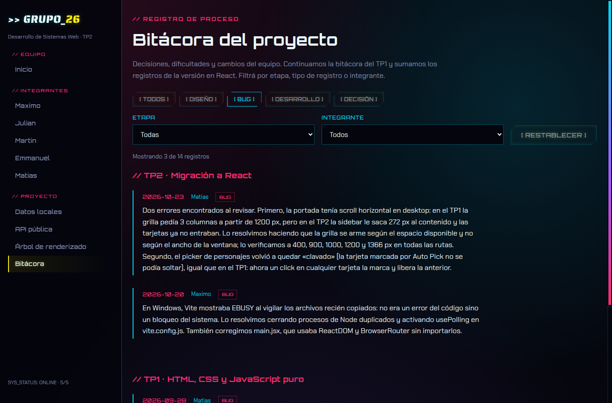

# TP2 · Grupo 26 — Plataforma del equipo en React (estética Cyberpunk 2077)

Aplicación web del **equipo 26** para el **Trabajo Práctico Grupal n° 2** de _Desarrollo de Sistemas Web FrontEnd (2026)_.
Continúa el sitio del TP1 (HTML, CSS y JavaScript puro) y lo lleva a **React**, con una **sidebar compartida** que organiza toda la navegación.

## Índice

1. [Descripción](#descripción)
2. [Deploy](#deploy)
3. [Integrantes](#integrantes) · [Responsabilidades](#responsabilidades-del-equipo)
4. [Tecnologías](#tecnologías) · [Cómo correrlo](#cómo-correrlo) · [Estructura](#estructura)
5. [Identidad visual](#identidad-visual) · [Guía de estilos](#guía-de-estilos)
6. [Funciones e interacciones](#funciones-e-interacciones)
7. [Capturas](#capturas)
8. [Uso de IA](#uso-de-ia)
9. [Evolución](#evolución-para-los-siguientes-trabajos) · [Entrega](#entrega)

## Descripción

Una sola aplicación navegable que contiene:

- **Portada del equipo** con presentación animada y acceso a los integrantes.
- **5 perfiles** dentro de React (`/perfil/:id`), cada uno con su función propia del TP1 rehecha con estado de React: filtro de contenido (Julian), elección al azar (Martin), lightbox (Emmanuel), terminal mainframe (Matias) y configurador de robot (Maximo).
- **Datos locales:** un JSON con 25 herramientas del equipo, con búsqueda por texto y filtro por categoría.
- **API pública:** perfiles reales de GitHub de los integrantes (sin claves), con mensajes de carga y de error.
- **Árbol de renderizado** de los componentes de la app.
- **Bitácora** que continúa la del TP1 con los registros del TP2.

## Deploy

> https://front-end-grupo26-tp-2.vercel.app/

## Integrantes

| Integrante                      | GitHub                                                |
| ------------------------------- | ----------------------------------------------------- |
| Maximo Ariel Pereira            | [PereiraMax](https://github.com/PereiraMax)           |
| Julian Piedrabuena              | [juliganSW](https://github.com/juliganSW)             |
| Martin Savia                    | [martin-2t](https://github.com/martin-2t)             |
| Emmanuel Valdez                 | [Emmanuel-Valdez](https://github.com/Emmanuel-Valdez) |
| Matias Mazzitelli               | [mdev-repos](https://github.com/mdev-repos)           |

### Responsabilidades del equipo

| Integrante | Responsabilidad en el TP2                                                                                                                                                  |
| ---------- | -------------------------------------------------------------------------------------------------------------------------------------------------------------------------- |
| Maximo     | Estructura base de la app React: proyecto Vite, rutas, `Layout` y `Sidebar`, datos iniciales, página de API y deploy. Configurador de robot de su perfil.                    |
| Julian     | Spinner de carga al entrar a cada perfil y filtro cine/música de su perfil.                                                                                                |
| Martin     | Búsqueda por texto y filtro por categoría en Datos, y elección al azar de películas y discos en su perfil.                                                                 |
| Emmanuel   | Lightbox de su perfil y carga de sus datos y contenidos.                                                                                                                   |
| Matias     | Árbol de renderizado expandible, bitácora con filtros, detalle desplegable en Datos, terminal mainframe de su perfil, selección de tarjetas en la portada, revisión visual (UX/UI) del proyecto y revisión contra la consigna y el README. |

## Tecnologías

React · React Router · Vite · CSS propio (variables, Grid, Flexbox) · API de GitHub · Google Fonts · Vercel.

## Cómo correrlo

```bash
npm install
npm run dev      # http://localhost:5173
npm run build    # genera /dist
```

## Estructura

```text
src/
  main.jsx · App.jsx          # entrada y rutas
  components/                 # Layout, Sidebar, MemberCard, MediaCard, SkillScanner,
                              # MediaSections, Lightbox, RobotConfigurator,
                              # TerminalMainframe, ItemCard, GithubCard, LogEntry, ...
  pages/                      # Home, Profile, Data, Api, RenderTree, Logbook, NotFound
  data/                       # members.json, items.json (25 registros), bitacora.json, robotData.js
  index.css                   # sistema de diseño "Nightscan" + estilos de layout
public/img/                   # imágenes de cada integrante
docs/capturas/                # capturas de pantalla usadas en este README
vercel.json                   # rewrite para que las rutas funcionen al recargar
```

## Identidad visual

Se mantiene la estética del TP1: fondos negro azulado con neones amarillo, cian, magenta y violeta; tipografías **Orbitron** (títulos), **Chakra Petch** (texto), **Saira Stencil One** (logo) y **Share Tech Mono** (terminal). Los avatares fueron generados o editados con IA por cada integrante.

### Guía de estilos

| Uso               | Color                    | Hex                   |
| ----------------- | ------------------------ | --------------------- |
| Fondo vacío       | negro azulado            | `#04050d`             |
| Paneles           | azul noche / alternativo | `#0a0d1f` / `#10142c` |
| Acento principal  | amarillo neón            | `#fcee0a`             |
| Acento secundario | cian                     | `#02d7f2`             |
| Acento alerta     | magenta                  | `#ff2a6d`             |
| Detalles          | púrpura                  | `#a45bff`             |
| Texto             | blanco hielo / gris      | `#eafcff` / `#8590b5` |

- **Iconografía:** favicon propio del equipo (`public/favicon.svg`, el "26" en cian/magenta del TP1), avatar placeholder (`public/img/avatar-placeholder.svg`) y símbolos de texto (`☰`, `📍`, `💻`, `▸`, `→`).
- **Responsive:** breakpoints en `400px`, `900px` y `1200px`, sin desbordes horizontales en ninguna sección. Debajo de `900px` la sidebar pasa a ser un panel opaco que se abre con `[ ☰ MENÚ ]` y se cierra con `[ ✕ CERRAR ]`, la tecla Esc o un click fuera. La grilla de integrantes se acomoda según el espacio disponible (no según el ancho de la ventana), y en pantallas chicas el avatar ocupa todo el ancho de la tarjeta.
- **Scrollbars:** barras de desplazamiento con la paleta del proyecto (pista negra azulada y degradado cian → violeta → magenta; en Firefox, cian sobre negro). En celulares y tablets se ve la barra del sistema, que el navegador no permite personalizar.
- **Composición de la pantalla:** la sidebar se separa del contenido con una línea fina de cian tenue (sin resplandor) y todas las secciones arrancan a la misma altura que el logo del equipo, con la etiqueta `// …` centrada ópticamente con él.

## Funciones e interacciones

### Estructura compartida (`Layout` + `Sidebar`)

- **Sidebar:** identidad del equipo, enlaces a todas las secciones y a los 5 perfiles; la sección activa se marca con `NavLink`. En mobile es un panel que abre y cierra, y se cierra solo al navegar.
- **Rutas:** React Router (`/`, `/perfil/:id`, `/datos`, `/api`, `/arbol`, `/bitacora`) y una pantalla 404 propia. `vercel.json` permite recargar cualquier URL sin error.

### Portada (`Home`)

- **Typewriter:** el texto de presentación se escribe letra por letra.
- **Reiniciar transmisión:** vuelve a escribir el texto y dispara un glitch pasajero en el título.
- **Selección de personaje:** `[ AUTO PICK CHARACTER ]` resalta un integrante al azar y lleva la vista a su tarjeta; también se puede hacer click directamente sobre cualquier tarjeta para marcarla. Siempre hay una sola marcada: al elegir otra se libera la anterior (el click sobre «Ver perfil» navega sin cambiar la selección).

### Perfiles (`Profile`, un solo componente para los 5)

- **Spinner** de carga al entrar a cada perfil (Julian).
- **Escanear habilidades:** barras animadas en cascada, con botón para re-escanear.
- **Interacción propia de cada integrante**, portada del TP1 a estado de React: filtro cine/música (Julian), elección al azar con mini ruleta (Martin), lightbox (Emmanuel), terminal mainframe (Matias) y configurador de robot con validación de compatibilidad (Maximo).

### Datos locales (`Data` + `ItemCard`)

- Búsqueda por texto y filtro por categoría sobre `items.json` (25 registros), con contador, aviso de "sin resultados" y botón para limpiar filtros.
- **Detalle desplegable:** cada tarjeta muestra lo esencial y el botón `[ + VER DETALLE ]` despliega quién la usa, el número de registro, el sitio oficial y un acceso `Ver más de <categoría> →` que aplica ese filtro.

### API pública (`Api` + `GithubCard`)

- Consulta `api.github.com/users/<usuario>` de cada integrante, sin claves: avatar, nombre, repositorios públicos, seguidores y año de creación de la cuenta.
- Estados de **carga** y **error** (incluye el límite de 60 consultas por hora de GitHub) y botón `[ REINTENTAR ]`.

### Árbol de renderizado (`RenderTree`)

- Representa la jerarquía real de componentes, desde `StrictMode` hasta las tarjetas, indicando el archivo de cada uno y cuántas veces se repite (`×N`).
- **Expandible y contraíble:** cada nodo es un componente recursivo (`TreeNode`) que guarda su propio estado abierto/cerrado; `▸` / `▾` abre o cierra cada rama y una rama cerrada muestra cuántos hijos tiene (`+N`). Los botones `[ EXPANDIR TODO ]` y `[ CONTRAER TODO ]` reinician todos los nodos a la vez.

### Bitácora (`Logbook` + `LogEntry`)

- Continúa la bitácora del TP1 y suma los registros del TP2, agrupados por etapa.
- **Filtros funcionales:** por tipo de registro (`[ DESARROLLO ]`, `[ DECISIÓN ]`, `[ DISEÑO ]`, `[ BUG ]`), por etapa (TP1 / TP2) y por integrante, combinables entre sí. Muestra cuántos registros coinciden, avisa cuando no hay ninguno y permite restablecer la lista completa.

## Capturas

<p align="center"></p>
<p align="center"><em>Portada: presentación animada y acceso a los integrantes.</em></p>

<p align="center"></p>
<p align="center"><em>Selección de personaje: una sola tarjeta marcada a la vez (por Auto Pick o por click).</em></p>

<p align="center"></p>
<p align="center"><em>Sidebar en mobile: panel que abre y cierra, con la sección activa marcada.</em></p>

<p align="center"></p>
<p align="center"><em>Perfil de un integrante: datos, habilidades e interacción propia.</em></p>

<p align="center"></p>
<p align="center"><em>Datos locales: 25 registros con búsqueda, filtro por categoría y detalle desplegable (acá, filtrado por «Herramientas» y con el detalle de Vite abierto).</em></p>

<p align="center"></p>
<p align="center"><em>API pública de GitHub con estados de carga y error.</em></p>

<p align="center"></p>
<p align="center"><em>Árbol de renderizado expandible.</em></p>

<p align="center"></p>
<p align="center"><em>Bitácora con filtros combinables (acá, solo los registros de tipo «Bug»).</em></p>

## Uso de IA

| Integrante | Aplicación | Modelo | Qué se hizo |
| --- | --- | --- | --- |
| Maximo | Claude (claude.ai, chat web) | Claude Sonnet 5.5 | Estructura React del TP2 (andamiaje comunicacional de intervención y participación sobre la producción), portado del configurador de robot y ayuda con errores de Vite/Windows. Avatar cyberpunk generado con una IA de imágenes (TP1). |
| Julian | Claude (Anthropic) | Claude Sonnet 5 | TP1: filtro de contenido. Avatar con Nano Banana 2 Lite. TP2: Se usó a Claude como guía para adaptar `react-spinners` a la paleta del sitio y entender cómo conectarlo con el estado de carga en `Profile.jsx` mediante `useEffect`. |
| Martin | Claude (claude.ai, chat web) y ChatGPT | Claude Sonnet 5 / GPT Image 2 para el desarrollo del avatar | TP1: base del sitio, función de elección al azar y avatar. TP2: con Claude se guio para entender y cumplir las consignas del trabajo y se generó el código de su parte (pasar la función de elección al azar a React dentro de su perfil). |
| Emmanuel | opencode | DeepSeek 4.1 + Beam free | TP1: verificación de datos, lightbox y porcentajes de skills. TP2: lightbox de su perfil, carga de sus datos y contenidos, revisión de navegación y datos, y asistencia con el código del perfil en React. |
| Matias | Claude Code | Claude Sonnet 5 (TP1) / Claude Opus 5.5 (TP2) | TP1: terminal mainframe, revisión de ramas y avatar con IA de imágenes. TP2: Árbol de renderizado expandible, bitácora con filtros y detalle desplegable en Datos; selección de tarjetas en la portada; ajustes visuales que yo detecté al revisar (desbordes, scrollbars, alineación, panel mobile); capturas y actualización del README. Revisé y probé cada cambio en el navegador (desktop y mobile). |

La IA se usó como ayuda; cada integrante revisó, adaptó y probó el resultado en su perfil.

## Evolución (para los siguientes trabajos)

- Revisar breakpoints y accesibilidad antes de cada entrega.
- Revisar accesibilidad (contraste y navegación por teclado) en todas las secciones.

## Entrega

En la planilla única de entregas se carga un solo enlace: el de este repositorio público. La URL de Vercel se revisa desde este README.
